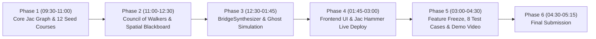

# 📋 IMPLEMENTATION PLAN (PLAN MODE) — UniPath LK

> **Target**: AI Hackathon 2026 Sri Lanka (University of Moratuwa)  
> **Core Language**: Jac Language v0.16.7 (Python 3.14.6 AMD64)  
> **Architecture**: Object-Spatial Graph + Council of Walkers + Meaning-Typed AI  
> **Execution Strategy**: Step-by-Step Vibe-Coding with Zero Syntax Errors

---

## 🎯 Plan Overview & Phased Roadmap



---

## 🚀 Phase 1: Core Knowledge Graph & Seed Data (`main.jac`)
**Goal**: Build the accredited Object-Spatial Graph with 12 real Sri Lankan institutions and evidence-backed transfer edges. Compile and test with `jac run main.jac`.

### 1.1 Archetype Definitions
- `obj AgentCritique`: Holds walker evaluations (`agent_name`, `is_viable`, `confidence`, `reason`, `financial_gap_lkr`).
- `node InstituteCourse`: Primary course node with `deliberation_board: list[AgentCritique]`, SLQF level (4/5/6), fees, IFSLS eligibility, and city.
- `edge BridgePathway`: Evidence-backed progression edge (`transition_type`, `requirements`, `source_id`, `verification_status`, `credits_transferred`, `is_synthetic`).
- `obj Pathway`: Composite multi-step trajectory with upfront costs, monthly burn rate, and IFSLS offsets.

### 1.2 Seed Walker (`walker :pub SeedGraph`)
Spawns 12 real Sri Lankan programs:
1. `SLIATE-HNDIT-GALLE` (SLQF 4, Free tuition, Galle)
2. `SLIATE-HNDE-COLOMBO` (SLQF 4, Free tuition, Mattakkuliya)
3. `ITUM-NDT-MORATUWA` (SLQF 4, Moratuwa)
4. `UCSC-BIT-EXT` (SLQF 5/6, Colombo External, Work-Study)
5. `UNIVOTEC-BTECH-SW` (SLQF 6, Lateral Entry)
6. `SLIIT-SE-HONOURS` (SLQF 6, IFSLS Eligible)
7. `NSBM-CS-DEGREE` (SLQF 6, IFSLS Eligible)
8. `KIU-BIOTECH-HONOURS` (SLQF 6, Bio Stream, IFSLS Eligible)
9. `NCOE-VIDYAPEETA` (SLQF 4, 100% Free Teaching Diploma)
10. `MOHE-CSC-SCHOLARSHIP` (SLQF 6, Full Scholarship)
11. `VTA-NVQ4-IT` (NVQ 4, Open to A/L failed students)
12. `OUSL-BSE-HONOURS` (SLQF 6, Open University)

### 1.3 Verification Command:
```powershell
jac run main.jac
# Expected: Clean terminal exit code 0, 12 nodes and verified edges initialized.
```

---

## 🤖 Phase 2: Council of Walkers & Spatial Blackboard
**Goal**: Implement the autonomous agents that traverse the graph and debate on `here.deliberation_board`.

### 2.1 Agents to Implement:
1. **`AspirationScout`**: Filters courses by A/L stream and career match.
2. **`FiscalSurvivalGuard`**:
   - Applies Living Cost Matrix: Colombo (LKR 38k/mo) vs Outstation (LKR 26k/mo) vs Home Commute (LKR 10k/mo).
   - Injects IFSLS Loan subsidy: Subtracts up to LKR 1.5M tuition + LKR 300k stipend.
   - Posts `AgentCritique` on `here.deliberation_board`. Tags unaffordable courses as `rejected_red`.
3. **`SLQFGatekeeper`**:
   - Verifies UGC/TVEC accreditation and checks `edge.verification_status`.
   - Posts compliance critique on `here.deliberation_board`.

---

## 🧠 Phase 3: AI Brain, Graph Metamorphosis & Ghost Simulation
**Goal**: Handle deadlocks with Dynamic Graph Metamorphosis and simulate future economic shocks.

### 3.1 Agents to Implement:
1. **`BridgeSynthesizer` (The Hero AI Brain)**:
   - When a student is deadlocked (state cutoff missed + private campus budget exceeded), calls `by llm(method="Reasoning")` (with deterministic fallback).
   - Spawns dynamic synthetic node `SYNTH-SLIATE-BIT-BRIDGE` (`here ++> InstituteCourse(...)`) and connects with `here +>: BridgePathway(is_synthetic=True) :+>`.
2. **`PathwayEvaluator` & 2-Stage Scoring**:
   - Stage 1: Binary Feasibility Gate (prunes 100% of hard violations).
   - Stage 2: Multi-Objective Preference Ranking (Lowest Cost, Fastest, Best Fit).
3. **`GhostWalker` (4-Year Future Shock Simulator)**:
   - Simulates Shock 1 (+15% inflation, +40% bus fare), Shock 2 (6-mo delay), Shock 3 (Year 2 internship +50k/mo).
   - Computes `resilience_score` (0–100%).
4. **Winning Features**:
   - `GapAnalyzerWalker`: Career goal gap finder.
   - `MinimumChangeFinder`: Sensitivity unlocker (+LKR 4,500/mo or commute).
   - `ActionPlanGenerator`: 5-step checklist for tomorrow morning.

---

## 💻 Phase 4: Full-Stack UI & Jac Hammer Deployment
**Goal**: Build a visual dashboard and deploy to Jac Hammer sandbox.

### 4.1 UI Components:
- **Left**: Student input panel (Z-score slider, budget slider, home commute toggle, 8 preset profile buttons).
- **Center**: Visual interactive graph with nodes turning Red, Green, and pulsing Gold (synthetic bridge). Clicking node opens its Spatial Blackboard (`deliberation_board`).
- **Right**: 3 Ranked Pathway Cards with Resilience Score bar, Minimum Change unlocker, and 5-Step Action Plan.
- **Bottom**: Structured Decision Log (`decision_log: list[str]`) for judges.

### 4.2 Deployment Commands:
```powershell
# 1. Run local REST server
jac start main.jac --port 8000

# 2. Push to GitHub
git add .
git commit -m "feat: complete UniPath LK multi-agent engine and dashboard"
git push origin main
```
Connect repository to **Jac Hammer (`https://jachammer.ai`)** with `GOOGLE_API_KEY` in settings.

---

## 🎬 Phase 5: 8 Pre-Crafted Test Cases & 2.5-Minute Demo Video
**Goal**: Run flawless demo scenarios without typing errors and record video.

### 5.1 Test Cases:
- **TP-1: Dinuka (Galle)** -> Z: 1.12, Budget: 25k -> Demonstrates Deadlock -> BridgeSynthesizer spawns dynamic bridge!
- **TP-2: Kaveesha (Gampaha)** -> Z: 1.35, Budget: 55k -> Unlocks SLIIT/KIU via IFSLS loan.
- **TP-3: Sithum (Kurunegala)** -> Z: 0.85, Budget: 15k -> Free SLIATE/ITUM -> UNIVOTEC B.Tech.
- **TP-4 to TP-8**: Matara, Colombo, Kandy, Jaffna, Kalutara profiles.

### 5.2 Video Script (2:30 min):
- `0:00 - 0:30`: Problem in Sri Lanka (250,000 stranded A/L students).
- `0:30 - 01:30`: Live demo of Dinuka (Galle student) -> Watch private nodes turn Red -> BridgeSynthesizer dynamically spawns Gold Bridge Node!
- `01:30 - 02:00`: Ghost Simulation (92% resilience under inflation shocks) + Minimum Change Finder.
- `02:00 - 02:30`: Code walkthrough (`main.jac`, nodes, walkers, `by llm`) + Jac Hammer live URL.

---

## 🏆 Phase 6: Submission (Before 05:15 PM Strict)
- GitHub Repo URL (`≥ 80% Jac code`).
- Jac Hammer Live URL.
- Demo Video link (YouTube/Loom).
- Written Architecture Description.
- Star Jac repository (`github.com/jaseci-labs/jac`).
