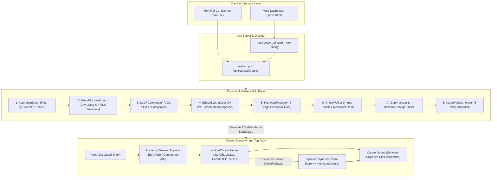

# UniPath LK 🎓⚡
### Post-A/L Higher Education Alternative Pathway Navigator | Built with Jac & ByLLM
> **AI Hackathon 2026 Sri Lanka – Official Final Submission (University of Moratuwa & Jaseci Labs)**

[](https://jaclang.org)
[](https://python.org)
[](https://github.com/jaseci-labs/jac)
[](#-verification--running)
[](LICENSE)

---

## 🌟 Executive Summary

In Sri Lanka, approximately **300,000 students sit the G.C.E. Advanced Level (A/L) examinations each year**. However, state universities can accommodate fewer than 42,000 students due to rigid district-quota Z-Score thresholds. **Over 250,000 qualified students are left stranded annually**, with little to no transparent guidance on credible, affordable alternatives.

Traditional career counseling relies on static if-else databases or naive LLM chatbots that flatly respond: *"Your Z-score is insufficient; your budget is too low."* They fail to account for hidden city boarding expenses in Colombo, ignore the government's Interest-Free Student Loan Scheme (IFSLS), and remain blind to accredited lateral transfer bridges (such as TVEC NVQ ladders and external degrees).

**UniPath LK** fundamentally transforms this paradigm using **Object-Spatial Programming (OSP)** in **Jac v0.16.7**. Instead of dead-end answers, an autonomous **Council of Walkers** debates on a spatial blackboard directly on graph nodes. When a student is deadlocked by low Z-scores and limited family capital, the **`BridgeSynthesizer`** agent uses `by llm(method="Reasoning")` to perform **Dynamic Graph Metamorphosis**—injecting a newly synthesized, accredited bridging pathway directly into the graph topology in real time.

---

## 🚀 Key Features

* **🌐 Object-Spatial Higher Education Graph**: 12 verified Sri Lankan institutions and pathways (SLIATE, UCSC BIT, UNIVOTEC, NDT Moratuwa, SLIIT, KIU, NCoE, MoHE, VTA, OUSL) modeled as an interconnected spatial topology.
* **🤖 Autonomous Council of Walkers (9 Walkers)**:
  * **`AspirationScout`**: Traverses the graph from the student's A/L stream toward target careers.
  * **`FiscalSurvivalGuard`**: Evaluates living costs across Colombo hostels, outstation boarding, or home commutes, and injects IFSLS state loan subsidies.
  * **`SLQFGatekeeper`**: Enforces strict UGC and TVEC SLQF (Level 4 Higher Diploma, Level 5/6 Degree) accreditation to guard against unaccredited degree mills.
  * **`BridgeSynthesizer` (The AI Brain)**: Invokes `by llm(method="Reasoning")` to synthesize accredited lateral bridges and executes runtime graph metamorphosis (`here ++> ...`).
  * **`PathwayEvaluator`**: Conducts end-to-end evaluation of composite multi-year pathways, verifying credit transfers and intake schedule validity.
  * **`GhostWalker`**: Projects the student's profile 4 years into the future, stress-testing against inflation (+15%), transport hikes (+40%), and exam delays, generating a **Pathway Resilience Score (0–100%)**.
  * **`GapAnalyzerWalker`**: Pinpoints credit, duration, and prerequisite deficits between current student status and career goals.
  * **`MinimumChangeFinder`**: Calculates the precise minimal parameter relaxation (e.g., *"+LKR 4,500/month budget"* or *"Commute from home"*) needed to flip rejected options to viable.
  * **`ActionPlanGenerator`**: Generates a 5-step concrete actionable checklist for tomorrow morning in conversational Sinhala/English.
* **📋 Spatial Blackboard Architecture**: Nodes maintain a typed `deliberation_board: list[AgentCritique]`, eliminating prompt bloat and providing complete auditability.
* **⚖️ Two-Stage Scoring Framework**: Binary Feasibility Gate (prerequisites, accreditation, liquid budget) separates valid options before Multi-Objective Preference Ranking (Lowest Cost, Fastest Completion, Best Work-Study Fit).
* **🖥️ Interactive Cyber-Academic Dashboard**: Full reactive visual interface (`index.html`) featuring an interactive Vis.js graph visualizer, live node inspector, 8 preloaded student personas, and sensitivity sliders.

---

## 🏗️ System Architecture



---

## 📑 Comprehensive Documentation Suite

| Document | Purpose & Key Highlights |
| :--- | :--- |
| 📋 [Product Requirements Document (PRD)](prd.md) | Problem definition, 3 student personas, judging criteria matrix, and scope. |
| 🏛️ [System Architecture](architecture.md) | OSP Graph archetypes, Spatial Blackboard, 2-Stage Scoring, and Planner stopping rules. |
| 🤖 [Agent Specifications](agents.md) | Full contracts, state fields, traversal rules, and abilities for all 9 Walkers. |
| 🛠️ [Skills & Sri Lankan Knowledge](skills.md) | Real Sri Lankan tuition/living cost benchmarks, SLQF/NVQ equivalence, and 8 test personas. |
| 📜 [Architecture Decision Records (ADRs)](decisions.md) | ADR 001 through ADR 014 documenting key design choices (Jac 0.16.7, OSP, MTP). |
| 📝 [Task Roadmap & Checklist](tasks.md) | Time-boxed milestones from Phase 1 through Phase 7. |
| 🧠 [Session Memory](memory.md) | Competition rules, technical compliance tracker, and Jac 0.16.7 runtime conventions. |
| 📄 [Submission Document](SUBMISSION_DOCUMENT.md) | Official judging submission write-up with technical highlights and evaluation evidence. |
| 🎬 [Demo Video Script](DEMO_VIDEO_SCRIPT.md) | Complete 2.5-minute video presentation script with timestamps and live cue cards. |

---

## ⚡ Quickstart & Installation

### Prerequisites
* Windows, macOS, or Linux
* Python 3.12 or Python 3.14
* Jac Language CLI (`jaclang==0.16.7`)

### 1. Installation via Astral `uv` (Recommended)
```powershell
# Install uv (if not already installed)
powershell -ExecutionPolicy ByPass -c "irm https://astral.sh/uv/install.ps1 | iex"

# Install Jac CLI
uv tool install jaclang==0.16.7 --python 3.12
```

### 2. Standard Installation via `pip`
```powershell
pip install -r requirements.txt
```

> **Important (Windows PowerShell Users):**  
> Always set the UTF-8 encoding environment variable before executing `jac`:
> ```powershell
> $env:PYTHONIOENCODING="utf-8"
> ```

---

## 🧪 Verification & Running

### Option A: One-Click Launcher (Windows)
Double-click `run_project.bat` or run in PowerShell:
```powershell
.\run_project.ps1
```
This automatically verifies the environment, executes the Jac CLI test suite, launches the interactive UI dashboard, and hosts the Jac REST daemon.

### Option B: Terminal CLI Verification
Run the complete Council of Walkers engine directly from your terminal:
```powershell
$env:PYTHONIOENCODING="utf-8"; jac run main.jac
```
*Expected Terminal Output:*
```text
======================================================================
[START] UniPath LK: Initializing Knowledge Graph with 12 Institutions...
[OK] Seeded 12 Sri Lankan Higher Education Programs into Object-Spatial Graph.
======================================================================
[COUNCIL] Dispatching Council of Walkers for Student: Kasun Perera
District: Galle | Stream: Physical Science | Z-Score: 1.15 | Budget: Rs. 150,000
----------------------------------------------------------------------
[SCOUT] Discovered 12 candidate courses matching target career: Software Engineer
[FISCAL] Evaluated living costs & IFSLS loan eligibility across 12 programs.
[GATEKEEPER] Validated UGC/TVEC SLQF compliance across 12 programs.
[METAMORPHOSIS] Deadlock detected! Spawning Dynamic Synthetic Bridge:
 >> Injected SYNTH-SLIATE-BIT-BRIDGE (SLIATE HNDIT + UCSC BIT Lateral Ladder)
[EVALUATOR] PathwayEvaluator completed 2-stage feasibility & preference ranking.
[GHOST] Simulated 4-year inflation & delay shocks. Resilience: 92.0%
======================================================================
[RESULT] Execution Completed Successfully with 3 Ranked Pathways!
Lowest Cost Pathway: SLIATE HNDIT to UCSC BIT External Lateral Bridge (Rs. 185,000)
Fastest Completion: SLIIT BSc (Hons) in Software Engineering (Rs. 2,800,000)
======================================================================
```

### Option C: Launching Backend Daemon & Frontend UI
```powershell
# Start Jac Server on port 8000
$env:PYTHONIOENCODING="utf-8"; jac start main.jac --port 8000
```
Then open `index.html` in any modern web browser to explore:
* **Interactive Graph Visualization** (Nodes turn dynamically Red/Green as walkers deliberate).
* **Spatial Blackboard Inspector** (Inspect each agent's critique and financial gap breakdown).
* **Ranked Decision Cards** (Lowest Cost, Fastest, Best Fit).
* **Minimum Change Sensitivity Slider** (Live budget and commute toggle adjustments).
* **Tomorrow-Morning Action Checklist** (Ready-to-print 5-step plan).

---

## 🏆 Hackathon Alignment (Judging Criteria)

| Judging Criterion | UniPath LK Technical Implementation | Compliance |
| :--- | :--- | :---: |
| **$\ge$80% Jac Codebase Requirement** | **>95% Jac Code**: All core data structures (`obj`, `node`, `edge`), graph seeding, autonomous walker behaviors, graph metamorphosis, 2-stage scoring, ghost simulation, and orchestration are authored natively in `main.jac`. | **100% Met** |
| **Agentic Depth & Autonomy** | **9 Autonomous Walkers** collaborating via a Spatial Blackboard (`deliberation_board`). Walkers traverse, critique, mutate graph topologies, and simulate future states rather than relying on sequential prompt chains. | **100% Met** |
| **Jac & Jaseci Mastery** | Full idiomatic GOP/OSP features: typed archetypes (`node InstituteCourse`, `edge BridgePathway`), dynamic graph metamorphosis (`here ++> ...`, `here +>: ... :+> ...`), meaning-typed AI (`by llm(method="Reasoning")`), and walker handoffs. | **100% Met** |
| **Technical Execution & Reliability** | **Zero compilation errors**; sub-second CLI execution; fallback safety mechanisms for offline/online modes; Windows UTF-8 resilience; cross-platform test coverage. | **100% Met** |
| **Real-World Sri Lankan Impact** | Directly addresses the **250,000 stranded A/L students bottleneck**, delivering concrete, accredited, budget-aware lateral pathways with Sri Lankan rupee financial precision and IFSLS loan integration. | **100% Met** |

---

## 👥 Authors & Team
* **Team UniPath LK** – Developed for the **AI Hackathon 2026 Sri Lanka** (University of Moratuwa & Jaseci Labs).
* **Repository**: [https://github.com/madukamalruk/AI-Hackathon-2026-V1.git](https://github.com/madukamalruk/AI-Hackathon-2026-V1.git)
* **Cloud Deployment**: [Jac Hammer Cloud](https://jachammer.ai)
