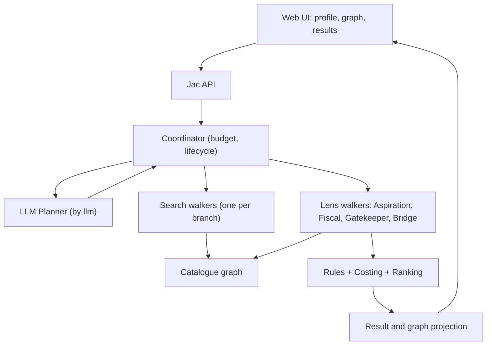

# UniPath LK: Hackathon Architecture (Practical + Winning Edition)

**Date:** 17 Oct 2026 | **Build window:** about 10:30 to 17:30 | **Language:** Jac (target 80%+ handwritten)
**Supersedes:** the long architecture MD and the PDF blueprint for today's build. Keep both as the long-term roadmap.

---

## 0. The one-paragraph pitch

UniPath LK finds **multi-step education routes** for Sri Lankan post-A/L students. Four lens walkers (Aspiration, Fiscal, Gatekeeper, Bridge) search a typed graph of real programmes and evaluate every route against the student's profile. An LLM planner decides what to do next, such as asking one clarifying question or searching an alternative. Deterministic code validates everything, so nothing is invented. The graph turns red, amber or green live, and unknowns are shown honestly.

**Differentiator:** most teams will demo a chatbot with fake confidence. We demo an agent that searches, disagrees with itself visibly, asks a question, and never fabricates.

---

## 1. Judging criteria to design decisions

| # | Criterion | What judges look for | What we build to hit it | Demo proof |
|---|---|---|---|---|
| 1 | **Depth of agentic behaviour** | Does the agent decide, or just show data? | LLM planner picks from 4 typed actions (`ask_student`, `search_alternatives`, `evaluate_candidates`, `finish`) based on observations. The Bridge walker uses the LLM to **rank and explain real catalogue routes**. Backtracking on dead ends. | Two different profiles trigger two different action sequences. An answer visibly changes the route. |
| 2 | **Excellent use of Jac/Jaseci** | Nodes, walkers, edges, `by llm` used meaningfully, 80% Jac | Catalogue = nodes + typed edges (`Offers`, `Awards`, `Requires`, `ProgressesTo`, `SupportsGoal`). One walker instance per branch. Four lens walkers. `by llm()` for the planner. All logic in Jac; frontend in native Jac client where supported. | 60-second source walkthrough, then the live graph projection from real nodes. |
| 3 | **Technical execution** | Live on Jac Hammer, no bugs | Modular monolith, one `jac.toml`, deterministic fallback if the LLM fails, 6 core tests, smoke flow run before demo. | Deployed URL works end to end, including with the API key removed (fallback). |
| 4 | **Creativity and innovation** | Something not seen before | **Council of lenses on a live graph**, **whole-route validation with three-valued logic**, **cash-flow cost model** (the cheap route is not always the cheap route), **stress test deltas**. | The "direct degree fails on cash, 3-step route works" moment. |
| 5 | **Impact and novelty** | Truly useful to people | Free, anonymous, no accounts. Shows costs, shortfalls, conditions, evidence links and next actions. Honest about uncertainty. Scales region by region by adding data only. | One real student problem solved start to finish. |
| 6 | **Presentation and 2-3 min demo** | Clear story | Fixed 5-beat script (section 12). Demo banner and evidence labels make honesty visible. | Rehearsed twice; screen recording captured as a backup. |

---

## 2. Scope: what is IN today and what is OUT

### IN (must work)

1. Profile form (goal, qualifications, savings, monthly budget, relocation, study mode).
2. Graph search: direct and multi-step routes, with cycle-safe, branch-isolated walkers.
3. Rule evaluator with three-valued logic (pass / fail / unknown).
4. Cash-flow costing (upfront vs monthly, minimum balance, shortfall).
5. Four lens walkers producing per-request findings shown on each node.
6. LLM planner with 4 actions, bounded budget and **rules fallback**.
7. One clarification question, then a recompute on the revised profile.
8. Graph UI: red / amber / green nodes and edges, click for rule + evidence.
9. Small **real IT-domain dataset** with per-claim evidence status, plus the **fictional fixture** for tests.
10. Stress test button (travel +40%, 6-month delay) showing deltas, with no probabilities.
11. Deployment on Jac Hammer and a smoke test.

### OUT today (documented roadmap only)

Accounts and saved plans, Minimum Change Finder, Gap Finder, multilingual UI, live scraping, admin tooling, loan modelling, parallel study/work, Z-score "chance of selection" numbers, nationwide data.

### Hard rules (never break these)

- No invented institutions, exemptions, fees or bridges shown as real.
- No "survival rate" or "89% confidence" numbers.
- The LLM never sets eligibility, writes to the catalogue, or fetches URLs.
- `null` (`None` in Jac) means unknown, never free or zero.
- Demo and real data are labelled visibly.

---

## 3. System overview

**Pattern:** the LLM suggests, deterministic code decides. State is **request-scoped** (stateless guest). The browser holds the profile and sends it in full each time with `conversation_id` and `profile_revision`.

---

## 4. The Council of Lens Walkers

| Lens | Type | Question it answers | Output (per node, per request) |
|---|---|---|---|
| **Aspiration** | Deterministic | Does this route actually support the chosen goal, and how well (award level, study mode, duration)? | `fit` tag and reason |
| **Fiscal** | Deterministic | Can the student fund this given savings and monthly budget? Minimum balance, shortfall, recurring gap. | `cash_ok / shortfall / unknown_cost` |
| **Gatekeeper** | Deterministic | Do entry requirements pass, fail or stay unknown? Is the evidence verified, unreviewed or fixture? | `pass / fail / unknown` + evidence IDs |
| **Bridge** | LLM-assisted, validated | When the direct route is blocked, which **existing catalogue routes** best repair it, and why? | Ranked route proposals plus plain-language explanation |

**Blackboard, done safely:** each lens emits `Finding` objects into a request-scoped list. The UI renders them as per-node notes ("Fiscal: needs 22,000 extra upfront. Gatekeeper: Diploma required first"). Nothing is written to shared nodes, so two users never mix.

**Bridge rules:**
- It may only choose among candidates produced by graph search, or among catalogue transitions marked `unreviewed`, which are drawn **amber** as "needs confirmation".
- Any proposal outside the catalogue is rejected by the validator and is never drawn as a route.
- The LLM output must change something real: ordering of alternatives and the explanation text. Verify this in a test with a stubbed LLM.

---

## 5. Domain model (trimmed for today)

Jac **nodes**: `Institution`, `Qualification`, `CourseOffering`, `CareerGoal`, `EvidenceClaim`.
Jac **objects**: `StudentProfile`, `RequirementExpr`, `CostItem`, `SearchState`, `CandidatePlan`, `Finding`, `Question`, `DecisionEvent`.
Jac **edges**: `Offers`, `Awards`, `Requires`, `ProgressesTo`, `SupportsGoal`, `SupportedBy`.

Key conventions:
- IDs are stable application IDs, not native graph IDs.
- Amounts are integer LKR. `None` (`null` in JSON) = unknown.
- A course is an **offering**: campus, mode and intake matter. UCSC BIT and Moratuwa BIT are different records.
- SLQF and NVQ claims are separate fields, each with its own evidence. Never infer one from the other.
- `ProgressesTo` carries `transition_type`, `requirements`, `evidence_claim_ids`, `status`, and an optional validated cost/duration change.

### Evidence status (per claim)

`verified` | `unreviewed` | `fixture` | `stale` | `rejected`

UI colours: verified = solid, unreviewed = amber, fixture = grey with a demo banner.

---

## 6. Data strategy: small now, scalable later

### 6.1 Two catalogues, one schema

| File | Purpose | Shown as |
|---|---|---|
| `data/demo/catalogue.json` | Fictional fixture with hand-checkable numbers (tests and fallback demo) | **DEMO** banner |
| `data/real/catalogue.json` | Small real IT-domain set | Per-claim status |

Both use the **same loader and schema**.

---

## 7. Search algorithm (Jac walkers)

- **One walker per branch** with its own immutable or copied `SearchState`. Never share one mutable accumulator across `visit` children.
- **Visited signature** = current offering + accumulated qualifications + transition history. Not a global "visited course" set.
- **Backtracking** (visible in the UI): a blocked branch is logged as a `DecisionEvent` ("blocked at X, retracing to fork Y, trying Z").
- **Limits (configurable):** 4 steps, 100 expanded states, 20 candidates, 3 shown. If hit, return `search_truncated: true`.
- **Deterministic ordering** so tests are repeatable.

---

## 8. Rules, status and cost

### Three-valued logic

| Group | Pass | Fail | Unknown |
|---|---|---|---|
| `all` | all children pass | any child fails | no fail, at least one unknown |
| `any` | any child passes | all children fail | no pass, at least one unknown |

### Route status (first match wins)

1. Known hard failure → `not_feasible_under_current_inputs` (red)
2. Missing data, evidence or essential cost → `needs_confirmation` (amber)
3. Future completion or selection required → `conditional` (amber-green)
4. Otherwise → `feasible_under_stated_assumptions` (green)

### Cash-flow model (monthly)

- Month 0 = start of the first course.
- Upfront costs are due at the start of the month; monthly contribution arrives at month-end.
- `balance = savings`; each month subtract upfront costs, record the minimum, add the contribution, subtract recurring costs, record the minimum.
- `extra_initial_cash_needed = max(0, -minimum_balance)`.
- Unknown essential cost → incomplete ledger → `needs_confirmation`, never "affordable".

### Fixture expectations (test oracle, fictional data)

| Route | Total | Minimum balance | Result |
|---|---:|---:|---|
| Direct degree | 84,000 | -22,000 | Needs 22,000 extra upfront |
| Foundation → Diploma → Top-up | 54,000 | 0 | Conditional on completing each step |
| Same direct route with savings 24,000 | 84,000 | 0 | Shortfall disappears |

### Stress test

Re-run the same engine with labelled changes: travel costs +40%, a 6-month delay, optional user-entered income. Show **absolute deltas** in cost, shortfall and duration. No probability or resilience percentage.

---

## 9. LLM planner and fallback

**Actions (typed, allowlisted):**
- `ask_student(field)`
- `search_alternatives(filters)`
- `evaluate_candidates(ids)`
- `finish`

**Fallback:** on missing key, timeout, malformed output or unknown IDs, switch to the deterministic question list. Report `planner_mode: live_ai | rules_fallback | mixed` and a `fallback_reason`. Never present fallback as AI reasoning.

---

## 10. API (logical operations)

| Operation | Purpose |
|---|---|
| `get_app_info` | Catalogue mode, version, feature flags |
| `get_catalogue_projection` | Whitelisted nodes and edges for the graph |
| `plan_pathways` | Full profile, revision, conversation ID → candidates, blocked candidates, pending question, events |
| `get_evidence` | Claim and source records |
| `run_stress_test` | Same profile plus a named scenario → deltas |
| `health` | Readiness (fails if the catalogue import failed) |

---

## 15. Tests (minimum set)

| ID | Assertion |
|---|---|
| T01 | Direct and multi-step candidates are both found |
| T02 | AND prerequisite missing → requirement fails despite an incoming edge |
| T03 | Unknown field → `unknown` and a relevant question |
| T05 | Fixture totals and shortfall match section 8 |
| T08 | Cycle terminates; branches do not contaminate each other |
| T11 | No key / timeout → labelled fallback |
| T13 | Tampered client result is ignored; server recomputes |
