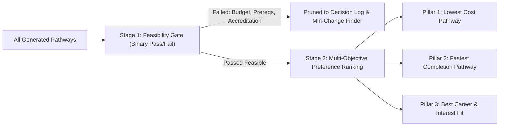

# 🏛️ Architecture & System Design — UniPath LK

## 1. Architectural Philosophy: Object-Spatial Intelligence & Pathway-Level Evaluation
Traditional AI applications rely on monolithic prompts dumped into an LLM, or shallow node-by-node filtering. **UniPath LK** uses Jac's native **Object-Spatial Programming (OSP)** with **End-to-End Pathway Evaluation**:
1. **The World is an Accredited Graph**: Academic programs, institutions, financing options (IFSLS), accreditation tiers, and careers form a persistent spatial topology.
2. **First-Class Pathway Evaluation**: Evaluating individual courses alone is insufficient because two good courses might have intake schedule clashes, lack credit transfer agreements, or create hidden fee gaps. The system evaluates the **Complete Academic Pathway** (`Pathway` object).
3. **Evidence-Backed Graph Edges**: Transitions between institutions carry formal legal and institutional evidence (`source_id`, `verification_status`, `transition_type`, `requirements`).
4. **2-Stage Scoring (Feasibility Gate -> Preference Ranking)**: Hard constraints (SLQF, budget, prerequisite passes) are evaluated first as a feasibility binary gate. Only feasible pathways enter multi-objective preference ranking (Lowest Cost, Fastest, Best Fit).
5. **Dynamic Graph Metamorphosis**: When existing pathways are deadlocked, `BridgeSynthesizer` uses `by llm(method="Reasoning")` to synthesize an accredited lateral pathway and injects a new `InstituteCourse` node and `BridgePathway` edge directly into the graph at runtime (`here ++> ...`).
6. **Structured Decision Log**: All agent operations, tool dispatches, and pruned options are recorded in an audit log visible to judges.

---

## 2. System Architecture Diagram

```mermaid
flowchart TD
    User["Student / Parent Client"] -->|HTTP POST /walker/RunPathwayCouncil| Server["Jac Server (jac start)"]
    
    subgraph Jac_Graph_Topology ["Object-Spatial Graph Topology"]
        RootNode["root (Jac Graph Entry)"]
        StreamNode["AcademicStream (Physical / Bio / Tech / Commerce / Arts)"]
        CourseNodes["InstituteCourse Nodes (SLIATE, UCSC BIT, UNIVOTEC, NDT, SLIIT, NCoE)"]
        InstNodes["Institution Nodes (UCSC, SLIATE, MoHE DAIs, UNIVOTEC)"]
        CareerNodes["Career Nodes (Software Engineer, Bio Researcher, Data Scientist)"]
        SyntheticBridge["Dynamic Synthetic Node (here ++> InstituteCourse)"]

        RootNode --> StreamNode
        StreamNode --> CourseNodes
        CourseNodes --> InstNodes
        CourseNodes --> CareerNodes
        CourseNodes -.->|Evidence-Backed Edge (BridgePathway)| SyntheticBridge
    end

    subgraph Council_Of_Walkers ["Council of Walkers & Pathway Evaluator"]
        W1["1. AspirationScout (Stream & Career Filter)"]
        W2["2. FiscalSurvivalGuard (Writes to Spatial Blackboard)"]
        W3["3. SLQFGatekeeper (Enforces UGC/TVEC on Blackboard)"]
        W4["4. BridgeSynthesizer (by llm - Injects Synthetic Bridge)"]
        W5["5. PathwayEvaluator (End-to-End Pathway Validator)"]
        W6["6. GhostWalker (4-Year Shock Simulation & Resilience)"]
        W7["7. GapAnalyzer & MinimumChangeFinder"]
        W8["8. ActionPlanGenerator (5-Step Checklist)"]

        W1 --> W2 --> W3 --> W4 --> W5 --> W6 --> W7 --> W8
    end

    Server --> Jac_Graph_Topology
    Council_Of_Walkers -.->|Traverse, Deliberate & Mutate| Jac_Graph_Topology
    W8 -->|Structured Multi-Pillar Response + Decision Log| User
```

---

## 3. Graph Archetypes (Nodes, Edges, Pathways)

```jac
# Typed critique stored on nodes (Spatial Blackboard)
obj AgentCritique {
    has agent_name: str;
    has is_viable: bool;
    has confidence: float;
    has reason: str;
    has financial_gap_lkr: float = 0.0;
    has timestamp_step: int = 1;
}

# Core educational node
node InstituteCourse {
    has code: str;
    has name: str;
    has institution: str;
    has slqf_level: int; # Level 4: HND, Level 5: Bachelor's General, Level 6: Bachelor's Honours
    has duration_years: float;
    has annual_tuition_lkr: float;
    has upfront_admission_fee: float;
    has monthly_living_lkr: float;
    has ifsls_eligible: bool;
    has allows_work: bool;
    has location_city: str;
    has deliberation_board: list[AgentCritique] = [];
}

# Evidence-backed graph edge
edge BridgePathway {
    has transition_type: str = "progression";       # 'admission', 'exemption', 'progression', 'lateral_entry'
    has requirements: list[str] = [];              # ['A/L 3 passes', 'NVQ Level 6 / HNDIT', 'CGPA >= 2.5']
    has source_id: str = "UGC_CIRCULAR_2024_03";    # Verification evidence source (e.g. Gazette, MOHE, UGC)
    has valid_for_intake: str = "2026/2027";       # Intake calendar validity
    has verification_status: str = "verified";     # 'verified', 'unverified', 'needs_confirmation'
    has added_duration_months: int = 0;            # Bridging semester / extra duration
    has added_cost_lkr: float = 0.0;               # Bridge / exemption / admission fees
    has credits_transferred: int = 60;
    has is_synthetic: bool = False;
    has rationale: str = "";
}

edge RequiresStream {
    has min_passes: int = 3;
    has allowed_streams: list[str];
}

edge OfferedBy {
    has is_state: bool;
    has ugc_recognized: bool = True;
}

edge UnlocksCareer {
    has employability_score: float;
}

# First-class composite pathway object
obj Pathway {
    has pathway_id: str;
    has title: str;
    has pillar: str;                               # 'Direct Degree', 'Lateral Ladder', 'External Work-Study'
    has courses: list[InstituteCourse];
    has transitions: list[BridgePathway];
    has total_cost_lkr: float;
    has upfront_cost_lkr: float;
    has monthly_burn_lkr: float;
    has total_duration_years: float;
    has ifsls_covered_lkr: float = 0.0;
    has out_of_pocket_lkr: float = 0.0;
    has funding_gap_lkr: float = 0.0;
    has is_feasible: bool = True;
    has feasibility_failures: list[str] = [];
    has verification_status: str = "verified";     # If any edge is unverified -> 'needs_confirmation'
    has resilience_score: float = 0.0;             # 0-100% computed by GhostWalker
    has preference_rank: int = 1;
}
```

---

## 4. The 4 Killer Agentic Mechanics & Evaluation Engine

### 1. Spatial Blackboard (`deliberation_board`)
Walkers do not pass opaque messages or bloat prompt context. Each `InstituteCourse` node maintains a `deliberation_board: list[AgentCritique]`.
- `FiscalSurvivalGuard` inspects the student's budget against tuition + city boarding (Colombo LKR 36k–45k vs Outstation LKR 25k–32k vs Home commute LKR 8k–12k) and posts an `AgentCritique(agent_name="FiscalGuard", is_viable=False, financial_gap_lkr=...)`.
- `SLQFGatekeeper` inspects UGC/TVEC accreditation and posts an `AgentCritique(agent_name="SLQFGatekeeper", is_viable=True)`.

### 2. End-to-End Pathway Evaluator (`PathwayEvaluator`)
Rather than judging isolated courses, `PathwayEvaluator` traverses sequential course pairs `Course A -> BridgePathway -> Course B`:
- Checks whether `Course A` end date overlaps with `Course B` intake window.
- Validates that `BridgePathway.requirements` are fully satisfied by `Course A`'s SLQF level.
- Accumulates total multi-year tuition, upfront admission deposits, and living burn rates.
- Flags any pathway containing `verification_status == "needs_confirmation"`.

### 3. Dynamic Graph Metamorphosis (`here ++> ...`)
When a student is caught in an educational deadlock (Z-score insufficient for state intake and family budget insufficient for direct private tuition):
`BridgeSynthesizer` uses `by llm(method="Reasoning")` with formal TVEC/UGC lateral transfer rules and creates a synthetic bridge node and edge directly in the graph memory:
```jac
synthetic = here ++> InstituteCourse(
    code="SYNTH-SLIATE-BIT-BRIDGE",
    name="SLIATE HNDIT to UCSC BIT Lateral Bridge",
    institution="SLIATE + UCSC External",
    slqf_level=6,
    duration_years=3.5,
    annual_tuition_lkr=65000.0,
    upfront_admission_fee=7500.0,
    monthly_living_lkr=12000.0,
    ifsls_eligible=False,
    allows_work=True,
    location_city="Galle / Online"
);
here +>: BridgePathway(
    transition_type="lateral_entry",
    requirements=["SLIATE HNDIT completed"],
    source_id="UCSC_EXTERNAL_BIT_REGULATIONS",
    verification_status="verified",
    credits_transferred=60,
    is_synthetic=True,
    rationale="TVEC NVQ 6 lateral progression"
) :+> synthetic;
```

### 4. Ghost Simulation (`GhostWalker`)
Simulates 4 years of future progression under real-world shocks:
- **Shock 1**: Inflation index (+15% living cost + 40% transport hike).
- **Shock 2**: 6-month national academic/exam delay.
- **Shock 3**: Year 2 student internship offset (+LKR 50,000/month).
Outputs a **Pathway Resilience Score** (0–100%).

---

## 5. Planner Actions & Stopping Rules

The planner executes within strict guardrails to prevent infinite loops and runaway token costs:

### Allowed Actions:
1. `search_courses(stream, target_career)`: Queries the graph for course nodes.
2. `check_transition(course_a, course_b)`: Validates edge requirements, source evidence, and intake timings.
3. `calculate_cost(pathway, student_budget, district, can_commute)`: Computes exact upfront, monthly burn, and IFSLS offsets.
4. `ask_student(clarification_type)`: Requests user clarification (e.g. "Can you commute from home?").
5. `compare_pathways(candidate_pathways)`: Performs 2-stage feasibility and preference ranking.
6. `revise_plan(failed_constraint)`: Spawns `BridgeSynthesizer` or invokes `MinimumChangeFinder`.

### Stopping Rules:
- **Max Replanning Rounds**: 3 rounds maximum.
- **Max Candidate Pathways**: 10 candidate pathways evaluated.
- **No Redundant Re-evaluation**: Once an option fails a hard prerequisite (e.g., missed 3 A/L passes), it is permanently pruned.
- **Evidence Fallback**: Any transition lacking a verified Gazette/UGC source is strictly labeled `"needs_confirmation"` rather than falsely claimed as verified.

---

## 6. Two-Stage Scoring Framework



- **Stage 1: Feasibility Gate (Binary)**:
  - Must meet A/L minimum passes (or NVQ alternative).
  - Must meet UGC or TVEC legal accreditation.
  - Total upfront deposit must not exceed family liquid savings.
  - If loan needed, must satisfy official IFSLS criteria.
- **Stage 2: Preference Ranking (Multi-Objective)**:
  - Rather than averaging everything into one misleading score, the system surfaces 3 distinct pillars and explains the trade-offs:
    1. **Lowest Cost**: Maximum government subsidy / free diploma ladder.
    2. **Fastest Completion**: Direct intake, full-time non-state degree.
    3. **Best Career Fit / Work-Study**: High industry apprenticeship synergy (e.g. BIT external while working).

---

## 7. Structured Decision Log (Auditable by Judges)

The orchestrator builds a structured `decision_log: list[str]` during execution:
```text
✓ Discovered 12 candidate programs matching Stream: Physical Science, Career: Software Engineer
✓ Pruned 4 programs failing minimum A/L pass requirements
✓ FiscalSurvivalGuard identified LKR 1,200,000 funding gap on 2 direct private campuses
? Queried relocation preference: Home commute from Galle enabled (Living cost reduced by LKR 24,000/mo)
✓ Deadlock detected: BridgeSynthesizer invoked by llm(method="Reasoning")
✓ Dynamic Graph Metamorphosis: Injected SYNTH-SLIATE-BIT-BRIDGE (SLIATE Labuduwa + UCSC BIT)
✓ PathwayEvaluator verified edge transitions against UGC Circular 2024/03
✓ GhostWalker simulated 3 shock scenarios: Pathway Resilience Score 92%
✓ Final 3 Ranked Pathways synthesized with 5-step actionable checklist
```

---

## 8. Failure Handling & Resiliency Matrix

| Failure Mode | System Response |
|---|---|
| **LLM Call Failure / Timeout** | Automatically falls back to deterministic rule-based graph pathways with zero crash. |
| **Unknown Tuition / Missing Fee** | Tagged as `"unknown_cost"`; strictly excluded from being marked as affordable until confirmed. |
| **Conflicting Source Evidence** | Tagged as `"needs_confirmation"`; displays advisory warning to student. |
| **No Feasible Path Available** | `MinimumChangeFinder` computes the exact minimal parameter shift needed (+LKR 4,500/mo or commute). |
| **Cycle in Graph Traversal** | Loop detection via `visited` node set and max traversal depth limit (depth $\le 4$). |

---

## 9. Runtime & Deployment Architecture
- **Jac Native Execution**: `jac run main.jac` (CLI test mode).
- **Jac Service Daemon**: `jac start main.jac --port 8000` (auto-exposes REST endpoints for walkers).
- **Jac Hammer Cloud Deployment**: Connected directly to GitHub repository with environment variables (`GOOGLE_API_KEY`, `OPENAI_API_KEY`).
- **Frontend Dashboard**: Interactive UI visualizing nodes turning red/green dynamically as walkers deliberate.
